<div align="center">

# SentimentPRO

### Turn YouTube comments into audience intelligence.

Understand the sentiment. Find the patterns. Hear what your audience is asking for.

**Arabic & English NLP · Interactive Analytics · AI Insights · Evidence-grounded Chat**

[](https://github.com/ismailhalawa-ctrl/SentimentPro-youtube/actions/workflows/ci.yml)
[](LICENSE)


[Explore the Screens](#product-tour) · [Discover the Features](#features) · [Run Locally](#quick-start) · [Read the Docs](#documentation)

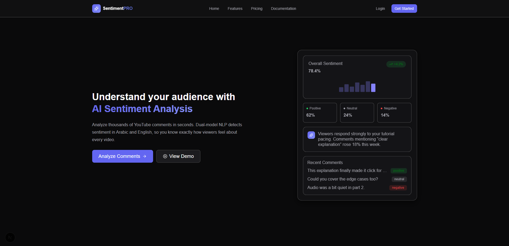

</div>

## Overview

**SentimentPRO is a full-stack YouTube comment analytics platform that turns a video's discussion into structured, actionable feedback.** Paste a YouTube URL, collect its comments, and explore sentiment, language, spam, sarcasm, recurring topics, and audience requests through one dashboard.

The platform combines local Transformer models with optional OpenAI or Gemini integrations. Local analysis provides the foundation; AI features add executive summaries, audience segments, complaint and suggestion extraction, FAQs, and a conversational assistant grounded in the comments you have analyzed.

For creators, it helps answer *“What resonated, and what should I improve?”* For community teams and researchers, it provides a way to inspect patterns, review supporting comments, and export the results.

> **Local-first sentiment analysis:** FAST mode does not require an OpenAI or Gemini key. A YouTube Data API key and a configured SQL Server database are still required for the normal video-analysis workflow.

<details>
<summary><strong>نبذة بالعربية</strong></summary>

SentimentPRO منصة لتحليل تعليقات فيديوهات YouTube وفهم رأي الجمهور بدل قراءة التعليقات واحدًا واحدًا. تحلّل المشاعر الإيجابية والسلبية والمحايدة، وتكتشف اللغة والتعليقات المزعجة ومؤشرات السخرية، وتعرض النتائج ضمن لوحة تفاعلية.

تدعم المنصة العربية والإنجليزية والتعليقات المختلطة، وتوفّر ملخصات وتقسيمات للجمهور واستخراجًا للشكاوى والاقتراحات والأسئلة المتكررة عند إعداد مزوّد ذكاء اصطناعي. ويمكنك محادثة مساعد يسترجع التعليقات ذات الصلة ويستند إليها في الإجابة، ثم تصدير التحليل بصيغ CSV وExcel وPDF.

</details>

## At a Glance

| Understand | Investigate | Act |
|---|---|---|
| Positive, neutral, and negative sentiment | Filter and inspect individual comments | Export CSV, Excel, and PDF reports |
| Arabic, English, and mixed-language feedback | Explore topics, keywords, and audience segments | Identify complaints and content requests |
| Spam and sarcasm indicators | Ask the assistant for evidence from comments | Turn summaries into follow-up ideas |

## Contents

- [Product Tour](#product-tour)
- [Features](#features)
- [Analysis Modes](#analysis-modes)
- [How It Works](#how-it-works)
- [Technology Stack](#technology-stack)
- [Quick Start](#quick-start)
- [Manual Development Setup](#manual-development-setup)
- [Configuration](#configuration)
- [Project Structure](#project-structure)
- [API and Developer Tools](#api-and-developer-tools)
- [Quality and Testing](#quality-and-testing)
- [Deployment Notes](#deployment-notes)
- [Documentation](#documentation)
- [Contributing](#contributing)
- [Project Origins](#project-origins)
- [Author and License](#author-and-license)

## Product Tour

### Analytics Dashboard

A central workspace for sentiment and language distributions, comment activity, engagement signals, keywords, and top comments. Use the comment explorer to move from a high-level pattern to the feedback behind it.

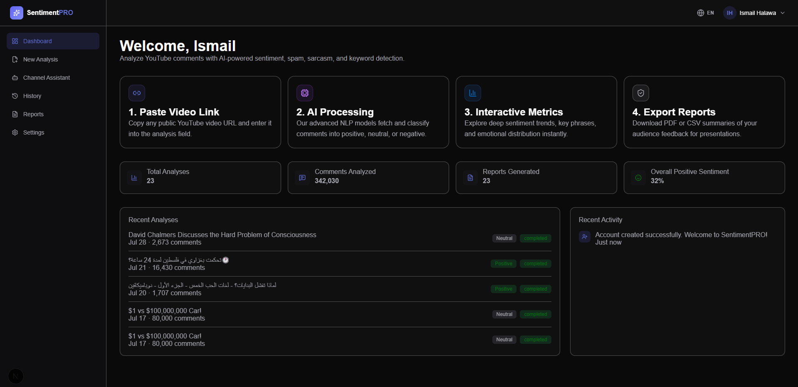

### Reports and Exports

Review analysis results in the reports workspace, then open a video's report to inspect its details and download results for sharing or further analysis.

<table>
  <tr>
    <td width="50%" align="center"><strong>Reports & Analytics</strong></td>
    <td width="50%" align="center"><strong>Per-Video Reports & Export</strong></td>
  </tr>
  <tr>
    <td>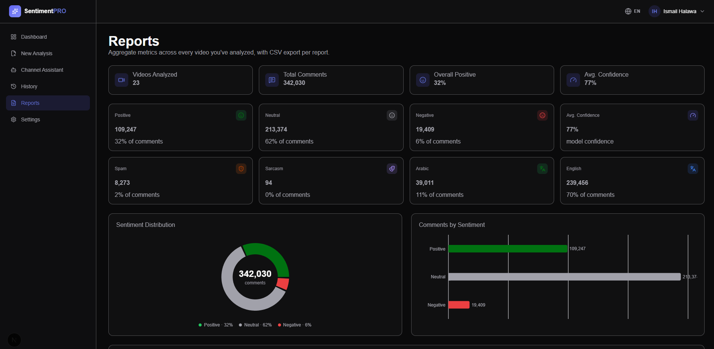</td>
    <td>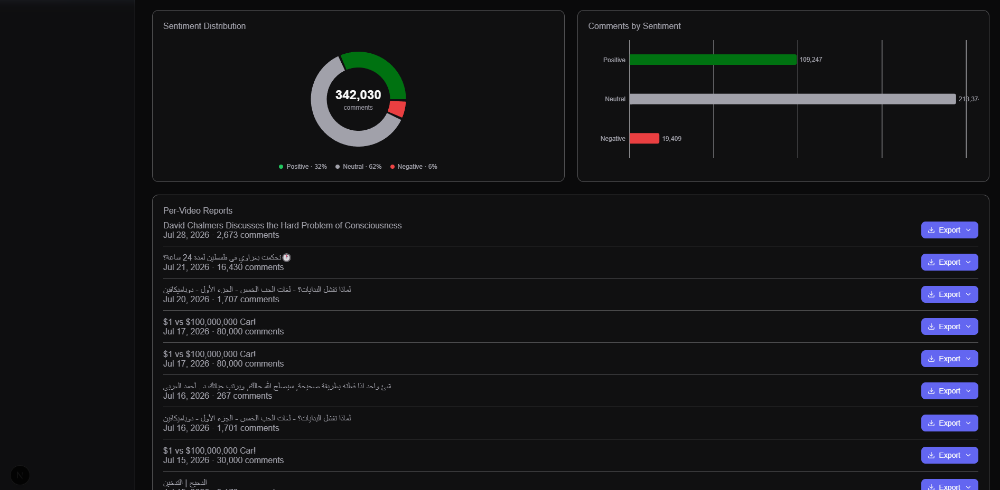</td>
  </tr>
</table>

### AI Insights and Executive Summary

Move beyond a sentiment count. Explore AI-generated interpretations of the discussion and a concise executive summary of the audience's feedback.

<table>
  <tr>
    <td width="50%" align="center"><strong>AI Insights</strong></td>
    <td width="50%" align="center"><strong>Executive Summary</strong></td>
  </tr>
  <tr>
    <td>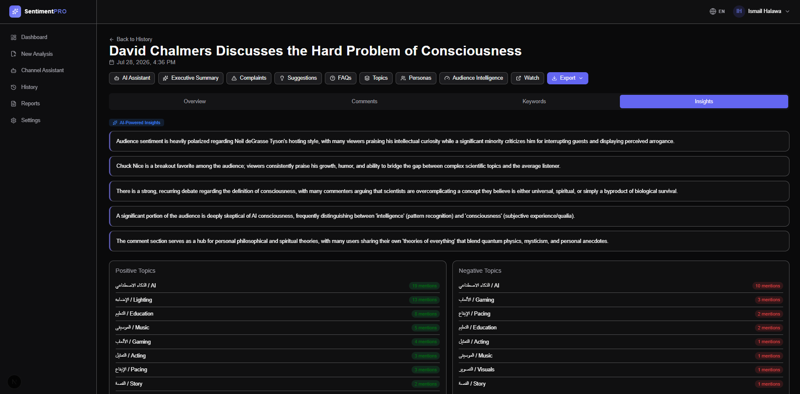</td>
    <td>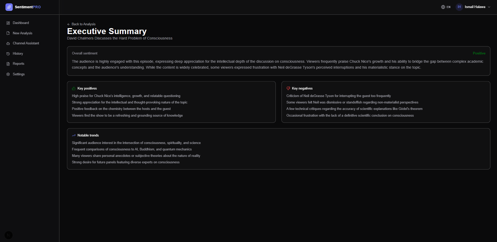</td>
  </tr>
</table>

### Audience Personas and Intelligence

Explore audience segments alongside satisfaction, community health, and loyalty indicators. These views help organize feedback into themes and signals you can investigate.

<table>
  <tr>
    <td width="50%" align="center"><strong>Audience Personas</strong></td>
    <td width="50%" align="center"><strong>Audience Intelligence</strong></td>
  </tr>
  <tr>
    <td>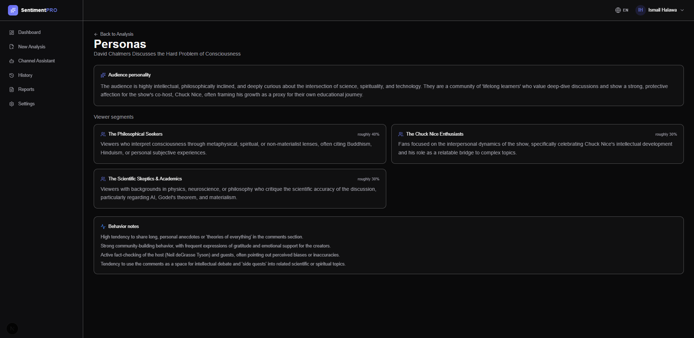</td>
    <td>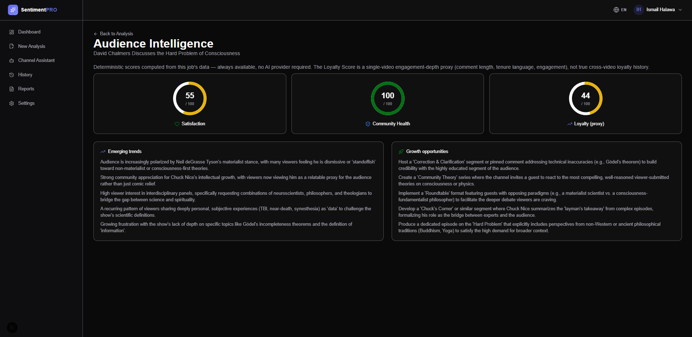</td>
  </tr>
</table>

### Audience Assistant

Ask questions in natural language and explore answers supported by retrieved comments. The assistant combines conversation history, analysis tools, and semantic retrieval to help investigate your analyzed videos.

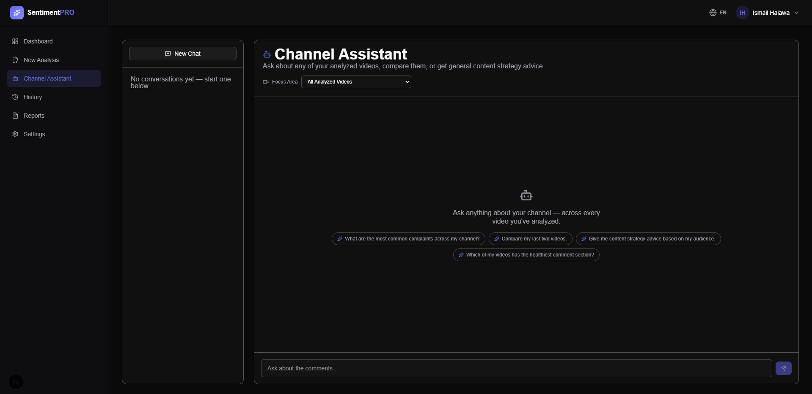

### Analysis History

Return to previous analyses through a per-user history, reopen a video's results, and manage saved jobs.

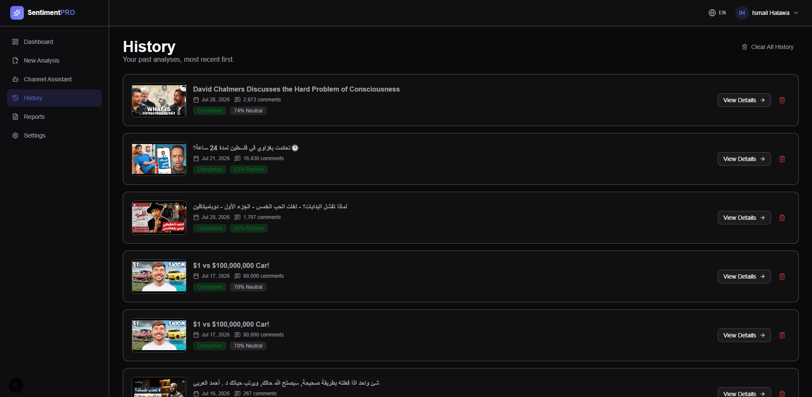

*Screenshots illustrate the interface; AI output and available integrations depend on the server configuration.*

## Features

### Multilingual Sentiment and Comment Signals

- **Sentiment classification:** positive, neutral, and negative labels with confidence information.
- **Arabic analysis:** a fine-tuned MARBERT classifier, with an XLM-R ensemble pass for uncertain Arabic predictions.
- **English analysis:** a fine-tuned RoBERTa sentiment classifier.
- **Mixed-language analysis:** a multilingual XLM-R provider for mixed Arabic/English sentiment.
- **Language detection:** separates Arabic, English, mixed, and other-language comments.
- **Context-sensitive rules:** emoji, negation, contrast, intent, and opinion signals complement model predictions.
- **Spam detection:** flags promotional patterns, suspicious links, contact spam, and related noise.
- **Sarcasm indicators:** rule-based signals help identify potentially sarcastic or contradictory comments.

Confidence values and rule-based indicators are model outputs, rather than guarantees of correctness. Context, dialect, and ambiguous wording can affect the result.

### Interactive Exploration

The dashboard brings together sentiment distribution, language distribution, a sentiment timeline, engagement comparisons, keywords, and top comments. A paginated comment explorer with filters lets you inspect the underlying text instead of relying only on aggregate charts.

Jobs expose progress and cancellation controls, while SQL Server stores analyses for later review. Reports can be exported as **CSV**, **Excel**, or **PDF**.

### AI Insights

| Capability | What it provides |
|---|---|
| **Executive summary** | A readable overview of the discussion and its main takeaways |
| **Audience personas** | Inferred audience segments based on patterns in the comments |
| **Complaints** | Feedback expressing problems, dissatisfaction, or friction |
| **Suggestions** | Improvement ideas, feature requests, and future content requests |
| **FAQs** | Recurring questions surfaced from the discussion |
| **Topic clustering** | Related comments organized into broader themes |
| **Audience Intelligence** | Deterministic satisfaction, community health, and loyalty scores, with an optional AI narrative |

Job-level insights are generated on demand and cached; analysis can also persist insights produced during LLM processing. LLM-dependent features require a configured provider and report availability through structured response statuses.

Audience personas are inferred segments, and the intelligence scores are heuristic indicators derived from the analyzed comments. They are useful for exploration, rather than verified demographic profiles or validated measures of the entire audience.

### Evidence-grounded Audience Assistant

The assistant uses retrieval-augmented generation (RAG): comments are embedded, stored in a vector index, and retrieved when relevant to a question. Analysis tools supply additional context, while responses can include citations to supporting comments.

Example questions:

- “What are viewers complaining about most?”
- “Which topics are people asking me to cover next?”
- “Summarize the negative feedback and show examples.”
- “What do Arabic comments say about this video?”

Local multilingual embeddings and **ChromaDB** are the default retrieval setup. OpenAI embeddings, Qdrant, and Pinecone are configurable alternatives. Generating conversational answers requires an OpenAI or Gemini key.

### Accounts and Platform Services

- Email/password authentication and optional Google OAuth.
- JWT sessions in HTTP-only cookies.
- Password reset with SMTP delivery when configured.
- Per-user analysis and assistant conversation history.
- Account settings and account deletion.
- Free/Pro subscription support through Stripe Checkout, Billing Portal, and signed webhooks.
- Daily/monthly request and token limits for the Audience Assistant, with separate Free/Pro settings.
- Contact/support messages stored in the database, with optional email forwarding.
- Redis-backed endpoint rate limiting and optional Sentry error monitoring.

## Analysis Modes

Choose the processing strategy according to your workload and provider configuration.

| Mode | Processing strategy | LLM key |
|---|---|---|
| **FAST** | Local Transformer models and deterministic rules, with batched inference and optional ONNX acceleration | Not required |
| **SMART** | LLM classification; large jobs use a local prepass and a stratified LLM sample, retaining local results for unsampled comments | Required for LLM classification |
| **HYBRID** | Local results first, followed by selective LLM refinement of ambiguous comments; comments outside the refinement sample retain their local results | Optional; local fallback when unavailable |

**How refinement is controlled:** the job service groups exact and near-duplicate comments before inference. SMART sampling is configured through `SMART_MODE_SAMPLE_SIZE`; HYBRID refinement through `HYBRID_LLM_SAMPLE_SIZE` (both default to 400 in the current settings). Stratification minimums can affect the final sample size.

HYBRID escalation considers low confidence, narrow model margins, mixed language, sarcasm, emoji signals, contrast, and other ambiguity indicators. Very short comments can be resolved locally. The final decision policy is configurable as `highest_confidence`, `llm_priority`, or `weighted_ensemble`.

See the [job orchestration service](backend/app/services/analysis_service.py) and [analysis pipeline](backend/app/ai/pipelines/analysis_pipeline.py) for the implementation.

## How It Works

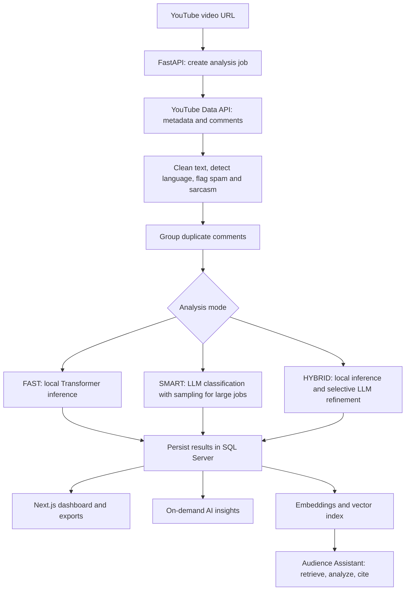

The frontend and backend are separate services. SQL Server stores users, jobs, comments, results, insights, subscriptions, and conversations. Redis provides shared rate-limit counters, while the vector store supports semantic comment retrieval.

For a deeper look at providers, database tables, and background jobs, see [Architecture](ARCHITECTURE.md).

## Technology Stack

| Layer | Technologies |
|---|---|
| **Frontend** | Next.js 16 App Router, React 19, TypeScript, Tailwind CSS v4 |
| **Visualization and motion** | Recharts, Framer Motion, Lucide icons |
| **Backend** | Python, FastAPI, Pydantic v2, SQLAlchemy 2, Alembic |
| **Database** | SQL Server through pyodbc |
| **Local AI** | PyTorch, Hugging Face Transformers, MARBERT, RoBERTa, XLM-R |
| **Inference optimization** | Batched processing, duplicate grouping, optional ONNX Runtime / INT8 quantization |
| **LLM integrations** | OpenAI, Gemini |
| **Retrieval** | sentence-transformers, ChromaDB; optional OpenAI embeddings, Qdrant, Pinecone |
| **Authentication** | PyJWT, passlib/bcrypt, Google OAuth |
| **Platform integrations** | Stripe, SMTP, optional Sentry |
| **Infrastructure and quality** | Docker Compose, Redis, GitHub Actions, pytest, Vitest, Ruff, mypy, ESLint, TypeScript |

## Quick Start

### Prerequisites

- **Git** and **Docker with Docker Compose**.
- A reachable **SQL Server instance** and an empty database.
- A SQL Server login that can connect to that database and apply migrations.
- A **YouTube Data API v3 key**.
- Internet access for initial model downloads and external API requests.

SQL Server is an external dependency: the Compose stack runs the frontend, backend, and Redis, and does **not** provision a database server.

### 1. Clone the project

```bash
git clone https://github.com/ismailhalawa-ctrl/SentimentPro-youtube.git
cd SentimentPro-youtube
```

### 2. Create the database

Run this in your SQL Server query tool:

```sql
CREATE DATABASE SentimentPRO;
```

Alembic creates the application tables; there is no need to create them manually.

### 3. Configure the backend

Copy the environment template:

```bash
# macOS / Linux
cp backend/.env.example backend/.env
```

```powershell
# Windows PowerShell
Copy-Item backend/.env.example backend/.env
```

Edit `backend/.env` and set at least:

```dotenv
DATABASE_URL=mssql+pyodbc://<username>:<password>@<host>:1433/SentimentPRO?driver=ODBC+Driver+18+for+SQL+Server
JWT_SECRET_KEY=<replace-with-a-strong-random-secret>
YOUTUBE_API_KEY=<your-youtube-data-api-v3-key>
CORS_ORIGINS=http://localhost:3000
FRONTEND_URL=http://localhost:3000
BACKEND_URL=http://localhost:8000
```

Generate a random JWT secret with:

```bash
python -c "import secrets; print(secrets.token_hex(32))"
```

Use a hostname reachable **from the backend container**. On Docker Desktop for Windows/macOS, use `host.docker.internal` if SQL Server runs on the host. Container connections need SQL Server or an appropriately configured Azure AD login; Windows `Trusted_Connection=yes` does not work automatically inside the Linux image. URL-encode special characters in connection-string credentials.

For a local development SQL Server with a self-signed certificate, the template includes `TrustServerCertificate=yes`. Production should use a trusted server certificate and certificate validation.

### 4. Start the stack

```bash
docker compose -f docker-compose.yml up --build
```

The explicit `-f` selects the base stack. This repository also contains a `docker-compose.override.yml` with machine-specific database and resource settings; review it before intentionally including it.

The backend applies `alembic upgrade head` before starting the API. Initial startup also downloads model weights and may export/quantize ONNX models, so the first launch takes longer than subsequent launches.

| Service | Local address |
|---|---|
| Web application | [localhost:3000](http://localhost:3000) |
| Backend API | [localhost:8000](http://localhost:8000) |
| Swagger UI | [localhost:8000/docs](http://localhost:8000/docs) |
| Health check | [localhost:8000/health](http://localhost:8000/health) |

### 5. Run your first analysis

1. Open the web application and create an account.
2. Start a new analysis and paste a YouTube video URL.
3. Choose **FAST** for local sentiment analysis, or configure an LLM provider for SMART/HYBRID refinement.
4. Follow job progress, then explore the dashboard and comments.
5. Open insights or the Audience Assistant when a provider is configured, and export your results.

Comment availability and collection depend on the video's comment settings and your YouTube API quota.

## Manual Development Setup

Use **Python 3.13** and **Node.js 22** to match the Docker images and CI configuration. Install Microsoft's **ODBC Driver 18 for SQL Server** and the platform's ODBC prerequisites before installing/running the backend.

<details>
<summary><strong>Backend setup</strong></summary>

From the repository root:

```bash
cd backend
python -m venv .venv
```

Activate the environment:

```bash
# macOS / Linux
source .venv/bin/activate
```

```powershell
# Windows PowerShell
.\.venv\Scripts\Activate.ps1
```

Install the dependencies:

```bash
python -m pip install -r requirements.txt
python -m pip install -r requirements-onnx-optional.txt
```

The environment template enables ONNX by default. Install its optional requirements as above, or set `USE_ONNX_RUNTIME=false` to use the PyTorch inference path.

Create `backend/.env` from `backend/.env.example` if you have not already done so, configure the database and API credentials, then run:

```bash
python -m alembic upgrade head
python -m uvicorn app.main:app --reload
```

Run backend commands from `backend/` so the environment file and relative cache paths resolve consistently.

</details>

<details>
<summary><strong>Frontend setup</strong></summary>

In a separate terminal, from the repository root:

```bash
cd frontend
npm ci
```

Create `frontend/.env.local` with:

```dotenv
NEXT_PUBLIC_API_URL=http://localhost:8000
```

Then start the development server:

```bash
npm run dev
```

For a production build, use `npm run build` followed by `npm start`. `NEXT_PUBLIC_API_URL` is embedded at build time; set it before building.

</details>

## Configuration

The [backend environment template](backend/.env.example) documents integrations and tuning options. Additional defaults, including sampling controls, are defined in [Settings](backend/app/core/config.py).

| Setting or group | Purpose | When needed |
|---|---|---|
| `DATABASE_URL` | SQL Server connection string | Core backend |
| `JWT_SECRET_KEY` | Signs authentication sessions | Core backend |
| `YOUTUBE_API_KEY` | Fetches YouTube metadata and comments | Video analysis |
| `CORS_ORIGINS`, `FRONTEND_URL`, `BACKEND_URL` | Browser origins, redirects, and generated links | Local/deployed URLs |
| `OPENAI_API_KEY` / `GEMINI_API_KEY` | LLM analysis, generated insights, and assistant answers | Optional AI features |
| `GOOGLE_CLIENT_ID`, `GOOGLE_CLIENT_SECRET` | Google sign-in | Optional OAuth |
| `SMTP_*` | Transactional password-reset email | Email delivery |
| `SUPPORT_EMAIL` | Receives a copy of contact submissions | Optional support inbox |
| `STRIPE_SECRET_KEY`, `STRIPE_PRICE_ID_PRO`, `STRIPE_WEBHOOK_SECRET` | Checkout, subscriptions, and verified webhook handling | Optional billing |
| `REDIS_URL` | Shared endpoint rate limiting | Set automatically in Compose |
| `EMBEDDING_PROVIDER`, `VECTOR_DB_PROVIDER` | Embedding and vector-store selection | Defaults work locally |
| `AI_DAILY_*`, `AI_MONTHLY_*` and `*_PRO` variants | Audience Assistant request/token limits | Usage policy |
| `SENTRY_DSN` | Error monitoring | Optional observability |

Without SMTP, password-reset links are logged for development instead of emailed. Without Stripe, subscription reads use the Free tier and checkout/portal operations report that billing is unavailable. Without an LLM key, FAST analysis remains available; generated AI features require configuration.

## Project Structure

```text
SentimentPro-youtube/
├── backend/
│   ├── app/
│   │   ├── ai/                 Providers, pipelines, rules, RAG, tools, scoring
│   │   ├── api/v1/             Versioned HTTP routes
│   │   ├── core/               Settings, authentication, rate limiting
│   │   ├── database/           Database engine and sessions
│   │   ├── models/             SQLAlchemy models
│   │   ├── schemas/            Request and response contracts
│   │   └── services/           Analysis, insights, assistant, billing, exports
│   ├── alembic/                Database migrations
│   ├── tests/                  Backend tests
│   └── .env.example            Backend configuration reference
├── frontend/
│   ├── app/                    Marketing, authentication, dashboard routes
│   ├── components/             Shared and feature-specific interface
│   ├── features/               Domain APIs, hooks, and types
│   └── lib/                    API client, i18n, and shared utilities
├── screens/                    Product screenshots
├── scripts/                    Smoke test and readiness verification
├── .github/workflows/          Continuous integration
├── docker-compose.yml          Base frontend, backend, and Redis stack
├── API.md
├── ARCHITECTURE.md
├── DEPLOYMENT.md
└── README.md
```

## API and Developer Tools

The backend exposes versioned routes under `/api/v1`. Interactive documentation is available at [Swagger UI](http://localhost:8000/docs) and [ReDoc](http://localhost:8000/redoc) after startup.

| Area | Responsibilities |
|---|---|
| `/auth` and `/users` | Registration, login, OAuth, password reset, account settings |
| `/youtube` | URL validation, video metadata, comment retrieval |
| `/analysis` | Job creation, progress, cancellation, history, comment results, exports, insights |
| `/audience-assistant` | Assistant sessions and conversational messages |
| `/billing` | Subscription status, checkout, billing portal, webhooks |
| `/support` | Contact form submissions |

Authenticated requests use the HTTP-only `access_token` cookie. Browser clients must include credentials when calling the API. See [API Reference](API.md) for endpoint details.

The root-level `GET /health` checks database connectivity and model readiness, returning **200** when healthy or **503** when degraded.

## Quality and Testing

The repository includes backend unit/integration/AI regression tests and frontend component/hook tests.

```bash
# From backend/; configure the test environment and SQL Server as needed
python -m pip install -r requirements-dev.txt
python -m pytest tests/ -v --cov=app
```

```bash
# From frontend/
npm ci
npm run test:coverage
npm run lint
npx tsc --noEmit
```

The [GitHub Actions workflow](.github/workflows/ci.yml) defines secret scanning, linting, type checks, dependency/security scans, backend and frontend tests, a frontend build, and Docker build/smoke checks. Markdown, screenshot, and documentation-only changes are excluded by its path filters. The badge above reflects the workflow status; no benchmark or test pass rate is implied here.

## Deployment Notes

- **Database:** use a reachable SQL Server instance, apply migrations, and configure database backups.
- **Secrets and origins:** provide real environment values and the deployed frontend/backend URLs. Production mode rejects weak or short JWT secrets.
- **Persistent storage:** Compose uses volumes for Redis data, ONNX artifacts, and the Chroma index.
- **Model resources:** size memory and CPU for the local model set. Extra worker processes duplicate model memory.
- **Job execution:** analyses run through FastAPI background tasks. Cancellation state is process-local; restart recovery and distributed job coordination require additional infrastructure.
- **Rate limiting:** use Redis to share endpoint limits across backend instances.
- **Optional integrations:** configure SMTP, OAuth, Stripe, and LLM credentials only for the features you intend to enable.
- **Frontend builds:** set the public API URL before building for a remote deployment.

See [Deployment](DEPLOYMENT.md) for operational details. Review the job-execution constraints before scaling to multiple backend replicas.

## Documentation

| Guide | What you will find |
|---|---|
| [Architecture](ARCHITECTURE.md) | Service boundaries, AI components, database schema, background jobs |
| [API Reference](API.md) | Authentication and endpoint overview |
| [Deployment](DEPLOYMENT.md) | Hosting, persistence, health checks, and scaling considerations |
| [Changelog](CHANGELOG.md) | Recorded project changes |
| [Environment Template](backend/.env.example) | Integration credentials and inference settings |
| [Settings Source](backend/app/core/config.py) | Configuration defaults, including sampling and assistant limits |

The README's mode descriptions reflect the current job service, including sampling for large jobs. Consult the implementation and generated OpenAPI schema when you need exact runtime behavior.

## Contributing

Contributions that improve multilingual analysis, accessibility, documentation, or developer experience are welcome.

1. Open an [issue](https://github.com/ismailhalawa-ctrl/SentimentPro-youtube/issues) describing the bug or proposed improvement.
2. Create a branch with a focused change.
3. Run the relevant checks and include validation details.
4. Open a pull request explaining the problem, the resulting behavior, and any configuration changes.

Useful future directions include durable background jobs, distributed cancellation, broader multilingual evaluation, and stronger visibility into AI usage and cost.

## Project Origins

SentimentPRO evolved from a Streamlit-based prototype into the current FastAPI and Next.js platform. The original application is preserved in [YouTube-Sentiment-Analyzer](https://github.com/ismailhalawa-ctrl/YouTube-Sentiment-Analyzer) for reference.

## Author and License

Created by **Ismail Halawa**.

[GitHub](https://github.com/ismailhalawa-ctrl) · [LinkedIn](https://www.linkedin.com/in/ismail-halawa-987aa52ab/) · [Email](mailto:ismaeelhalawa20003@gmail.com)

Released under the [MIT License](LICENSE). Model weights and third-party services remain subject to their own licenses and terms.

---

<div align="center">

<strong>From a comment section to a clearer picture of your audience.</strong>

[Back to top](#sentimentpro)

</div>

